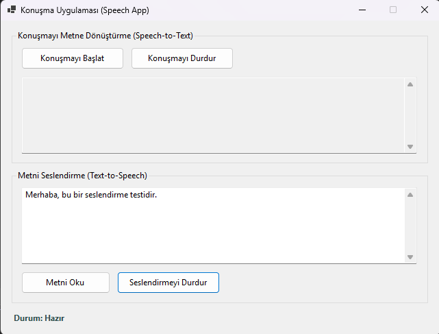
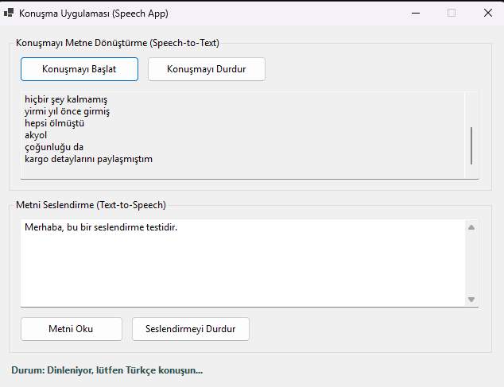

# Konuşma Uygulaması

Bu projede C# kullanarak metin seslendirme ve Türkçe konuşma tanıma özelliklerini içeren basit bir uygulama yaptım.

## Kullanılan Teknolojiler
- C#
- Windows Forms (.NET 8)
- System.Speech (Metin Seslendirme - TTS)
- Vosk (Çevrimdışı Türkçe Konuşma Tanıma - STT)
- NAudio (Mikrofon Ses Girişi)

## Özellikler
- Yazılan metni sesli okuma (Text-to-Speech)
- Seslendirmeyi anında durdurabilme
- Mikrofondan Türkçe konuşmaları metne dönüştürme (Speech-to-Text)

## Model Kurulumu
Uygulamanın Türkçe konuşmaları tanıyabilmesi için çevrimdışı Vosk modeline ihtiyacı vardır:
1. [vosk-model-small-tr-0.3.zip](https://alphacephei.com/vosk/models/vosk-model-small-tr-0.3.zip) dosyasını indirin.
2. Arşivden çıkan dosyaları projedeki `SpeechApp/model` klasörünün içine yerleştirin.

## Çalıştırma
Projeyi Visual Studio ile açıp F5 tuşuna basarak çalıştırabilirsiniz.

## Ekran Görüntüleri

